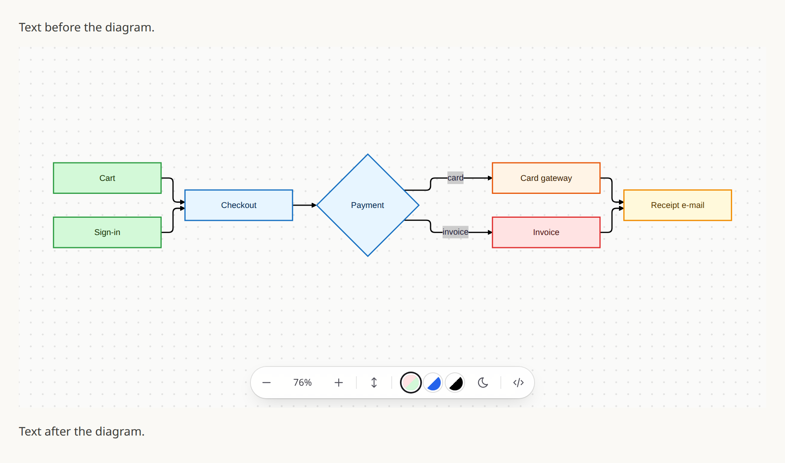

<div align="center">


<h1>mermaid-canvas</h1>

<h3>Mermaid-диаграммы в чате Claude — рисунком, а не кодом.</h3>

<p>
  Плагин Claude Code для десктопного приложения Claude.<br />
  Claude рисует диаграмму прямо в ответе, на холсте, который можно двигать, приближать, перекрашивать и копировать.
</p>

<p><a href="../../README.md">English</a> · <strong>Русский</strong></p>

<p>
  <a href="https://github.com/Armontex/claude-mermaid/actions/workflows/check.yml"></a>
  <a href="https://docs.claude.com/en/docs/claude-code/plugins"></a>
  <a href="https://mermaid.js.org/"></a>
  <a href="https://modelcontextprotocol.io/"></a>
  <a href="../../LICENSE"></a>
  <a href="#состояние-проекта"></a>
</p>

<p>
  <a href="#зачем">Обзор</a> ·
  <a href="#установка">Установка</a> ·
  <a href="#как-пользоваться">Использование</a> ·
  <a href="#разработка">Разработка</a> ·
  <a href="#планы">Планы</a>
</p>

</div>

<p align="center">
  <picture>
    <source media="(prefers-color-scheme: dark)" srcset="../../assets/demo-dark.png" />
    
  </picture>
</p>

<p align="center"><sub>Снято с <code>demo/host.html</code> — тестового хоста, на котором проверяется вьювер. В приложении холст стоит внутри ответа точно так же.</sub></p>

---

## Зачем

Десктопное приложение Claude показывает блок ` ```mermaid ` простым текстом:
диаграмму приходится читать как исходник или вставлять куда-то ещё.
mermaid-canvas даёт Claude инструмент `mermaid`, и приложение рисует каждый его
вызов живым холстом посреди ответа.

| Без плагина                        | С ним                                                    |
| ---------------------------------- | -------------------------------------------------------- |
| Блок кода с исходником mermaid     | Нарисованная диаграмма между абзацами о ней              |
| Чтобы увидеть, надо скопировать    | Зум, перемещение, «вписать», темы, исходник и обратно    |
| Одинаково в светлой и тёмной теме  | Холст открывается в теме приложения                      |

Claude передаёт тот же исходник mermaid, что написал бы в блоке кода, поэтому
диаграмма стоит столько же токенов, сколько раньше.

## Как это работает

1. Плагин запускает небольшой MCP-сервер. Его единственный инструмент,
   `mermaid({ source })`, ссылается на собственную страницу
   (`ui://mermaid-canvas/viewer-<hash>.html`) и поэтому становится
   [MCP App](https://modelcontextprotocol.io/).
2. В десктопном приложении хук `SessionStart` говорит Claude рисовать
   диаграммы этим инструментом, а не блоком кода.
3. Когда Claude его вызывает, приложение вставляет страницу в ответ и передаёт
   ей `source` из вызова; страница рисует его через Mermaid в теме приложения.

Диаграмма рисуется на вашем компьютере, внутри этого фрейма: её исходник никуда
не отправляется. Страница загружает Mermaid с esm.sh, Tailwind с jsDelivr и
шрифт JetBrains Mono с Google Fonts.

## Возможности

- **Любой тип диаграмм Mermaid** — блок-схемы, sequence, class, state, ER,
  Gantt, mindmap и всё остальное из Mermaid 12.
- **Настоящий холст** — перетаскивание, зум колесом к курсору, двойной клик для
  приближения, одна кнопка, чтобы вписать.
- **Три темы, светлая и тёмная** — `live`, `ink` и `print`; холст открывается
  в теме приложения.
- **Исходник** — номера строк, подсветка и кнопка копирования.
- **Классы статусов** — отметьте узлы как готовые, отсутствующие,
  заблокированные, в работе или под риском, и тема их раскрасит.
- **Ставить ничего, кроме плагина** — у сервера нет зависимостей, страница
  приходит собранной.
- **Без устаревшего вьювера** — адрес страницы зависит от её содержимого,
  поэтому после обновления приложение не достанет старую версию из кэша.

## Установка

Нужно:

- десктопное приложение Claude с Claude Code (вкладка Code);
- Node.js 18 или новее в `PATH`.

```bash
claude plugin marketplace add Armontex/claude-mermaid && claude plugin install mermaid-canvas@mermaid-canvas
```

Или внутри Claude Code: `/plugin marketplace add Armontex/claude-mermaid`,
затем `/plugin install mermaid-canvas@mermaid-canvas`.

После этого откройте новую сессию: сервер и хук подключаются при её старте.

### Обновление

```bash
claude plugin marketplace update mermaid-canvas && claude plugin update mermaid-canvas@mermaid-canvas
```

## Как пользоваться

Попросите диаграмму или что-то, что диаграмма объясняет: «нарисуй процесс
оформления заказа», «покажи, как эти сервисы общаются». Claude вызовет
`mermaid`, и холст появится в ответе.

### На холсте

| Действие                                              | Что делает                          |
| ----------------------------------------------------- | ----------------------------------- |
| Перетаскивание                                        | Двигает схему                       |
| Колесо после клика, Ctrl/⌘ + колесо или щипок         | Зум к курсору                       |
| Двойной клик                                          | Приближает                          |
| `−` / `+`                                             | Отдаляет / приближает               |
| Процент                                               | Вписывает схему в холст             |
| `↕`                                                   | Делает холст выше и обратно         |
| Кружок темы                                           | Тема: `live`, `ink`, `print`        |
| Солнце / луна                                         | Светлый или тёмный холст            |
| `</>`                                                 | Исходник с кнопкой копирования      |

Колесо над холстом, по которому ещё не кликали, прокручивает чат, так что
диаграмма не зумится, пока вы листаете мимо.

### Классы статусов

Пять классов раскрашивает каждая тема в обоих режимах — в блок-схемах и
диаграммах состояний. Claude пользуется ими, когда схема показывает состояние
работы:

| Класс     | Значит                     |
| --------- | -------------------------- |
| `ok`      | готово, работает           |
| `none`    | нет, не начато             |
| `blocked` | ждём кого-то другого       |
| `ours`    | в работе сейчас            |
| `warn`    | под риском                 |

```text
flowchart LR
  Cart:::ok --> Checkout:::ours --> Gateway:::blocked
```

`classDef` для них не нужен; написанный в исходнике заменяется темой.

### Вьювер на любой странице

Вьювер — обычный ES-модуль и работает где угодно:

```html
<div id="d"></div>
<script type="module">
  import view from 'https://cdn.jsdelivr.net/gh/Armontex/claude-mermaid@v0.1.0/viewer/view.js';
  view('d', `flowchart LR
    A:::ok --> B:::blocked`);
</script>
```

## Состояние проекта

mermaid-canvas в начале пути: `0.1.0` — первая версия, которая рисует в
приложении.

| Где                                  | Что получится                                             |
| ------------------------------------ | --------------------------------------------------------- |
| Десктопное приложение Claude, Code   | Холст прямо в ответе                                      |
| Claude Code в терминале              | Хук молчит, Claude пишет обычный блок кода                |
| Другие хосты, рисующие MCP Apps      | Должно работать, пока не проверено                        |

## Качество и тесты

```bash
npm run check
```

Biome проверяет формат и линт, затем `node --test` запускает тесты:

- протокол сервера: инструмент, его страница, разрешённые CDN, ошибки;
- `dist/viewer.html` совпадает со свежей сборкой исходников;
- каждая тема раскрашивает каждый класс статуса в обоих режимах;
- подсветка исходника и подстановка классов статусов;
- хук `SessionStart` говорит только в десктопном приложении;
- манифест плагина, запись маркетплейса и тег релиза согласованы.

`demo/host.html` — тестовый хост MCP Apps: открывает `dist/viewer.html`,
отвечает на рукопожатие и передаёт ему диаграмму, по умолчанию в тёмной теме,
с `?theme=light` — в светлой.

## Разработка

```bash
npm ci
npm run check
```

| Команда          | Назначение                                     |
| ---------------- | ---------------------------------------------- |
| `npm run check`  | Biome и все тесты, как в CI                    |
| `npm run build`  | Собрать вьювер в `dist/viewer.html`            |
| `npm run format` | Исправить форматирование                       |
| `npm test`       | Только тесты                                   |

После правки в `viewer/` запустите `npm run build`: собранная страница лежит в
репозитории, потому что у установленного плагина нет шага сборки.

Подключить свою копию как плагин:

```bash
claude plugin marketplace add "$PWD" && claude plugin install mermaid-canvas@mermaid-canvas
```

Плагин читается прямо из папки, и каждая новая сессия видит изменения.

Поднимите сервер в корне репозитория (`python3 -m http.server`) и откройте
`demo/` — вьювер сам по себе, или `demo/host.html` — вьювер как MCP App.

### Релиз

1. Поднимите `version` в `.claude-plugin/plugin.json` и тег в адресе вьювера
   выше одновременно; тест следит за парой.
2. Поставьте на коммит релиза тег `v<version>` и запушьте его.

### Структура

```text
.claude-plugin/   # манифест плагина (с MCP-сервером) и запись маркетплейса
hooks/            # SessionStart: рисуй диаграммы инструментом mermaid
mcp/server.mjs    # MCP-сервер через stdio, без зависимостей
viewer/
├── view.js       # холст: очередь рендера, зум, перемещение, панель
├── app.js        # холст как MCP App: рукопожатие с хостом
├── themes/       # по файлу на тему, регистрация в index.js
├── statuses.js   # классы статусов, которые раскрашивают темы
└── highlight.js  # вид исходника
dist/viewer.html  # собирается npm run build, отдаётся сервером
demo/             # страница вьювера и тестовый хост MCP Apps
test/             # тесты node --test
```

## Планы

- [ ] Подхватывать смену темы приложения, пока диаграмма открыта.
- [ ] Экспорт рисунка в SVG и PNG.
- [ ] Проверить другие хосты MCP Apps, начиная с claude.ai в браузере.
- [ ] Опубликовать в каталоге плагинов Claude Code.

## Если что-то не так

**Claude всё равно пишет блок кода.** Откройте новую сессию после установки:
хук срабатывает при её старте. `claude plugin list` должен показывать
`mermaid-canvas@mermaid-canvas` включённым.

**Вызов виден, холста нет.** Проверьте, что сервер поднят:

```bash
claude mcp list
```

У `plugin:mermaid-canvas:mermaid-canvas` должно быть `✔ Connected`; если нет,
проверьте, что `node --version` — 18 или новее.

**Колесо прокручивает чат.** Так задумано: сначала кликните по холсту или
держите Ctrl/⌘.

Удалить плагин:

```bash
claude plugin uninstall mermaid-canvas@mermaid-canvas
```

## Лицензия

mermaid-canvas распространяется под [лицензией MIT](../../LICENSE).
